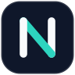

<p align="center">
  
</p>

<h1 align="center">Norn-M</h1>

<p align="center">Self-hosted, long-term memory for your AI agents.</p>

Norn-M gives Claude Code, Devin, omp and any other MCP-capable agent one shared memory that lives on your own network. Agents save facts, preferences and decisions as they work, and recall them in later sessions, on any device.

## Features

- **Shared memory over MCP.** One endpoint at `/mcp`; every agent configured with the same user reads and writes the same memories.
- **Semantic search.** Memories are extracted and embedded by the LLM and embedder you choose, then found by hybrid search.
- **Exact records.** Passwords, keys, IPs and other values that must not change are stored verbatim, never sent to an LLM, and found by deterministic keyword search.
- **Provenance.** Every write records its device, agent, project, folder and API key, so you can filter memories by any of them.
- **Dashboard.** Browse and search memories, manage API keys, categories, webhooks and consolidation, view analytics, export data, and set up new agents with a copy-paste prompt. English and Chinese.
- **Scoped API keys.** Limit a key to read-only access, or to chosen users, agents, runs or categories.
- **No telemetry.** Nothing leaves your machine except calls to the LLM, embedder and webhooks you configure.

## Quick start

Requirements: Docker with Compose, and an API key for an LLM provider (OpenAI, Anthropic, Gemini, DeepSeek, or any OpenAI-compatible endpoint).

```bash
cd server
cp .env.example .env    # set POSTGRES_PASSWORD, JWT_SECRET and your LLM key
make bootstrap          # builds and starts the stack, creates an admin and the first API key
```

`make bootstrap` prints the admin password and API key once; save them. To finish setup in the browser instead, run `make up` and open the dashboard.

| | URL |
|---|---|
| Dashboard | `http://localhost:3000` |
| API | `http://localhost:8888` |
| OpenAPI explorer | `http://localhost:8888/docs` |
| MCP endpoint | `http://localhost:8888/mcp` |

## Connect an agent

On the dashboard's **API Keys** page, click **Connect an agent**, copy the prompt and paste it into your agent. It registers the server and checks the connection. To do it by hand, for Claude Code:

```bash
claude mcp add --transport http --scope user norn-m http://localhost:8888/mcp \
  --header "X-API-Key: nmsk_your_key_here" \
  --header "X-Norn-M-User-Id: alice" \
  --header "X-Norn-M-Device: mac" \
  --header "X-Norn-M-Agent: claude-code"
```

See [Connecting agents](docs/agents.md) for Devin, omp and other clients.

## Documentation

- [Connecting agents](docs/agents.md)
- [REST and MCP API](docs/api.md)
- [Configuration](docs/configuration.md)
- [Running the server](server/README.md): operations, backups, password reset

## Repository layout

| Path | What it is |
|---|---|
| `norn_m/` | The memory library: extraction, search, LLM, embedder and vector-store providers |
| `server/` | FastAPI server with the REST API and MCP endpoint, plus Postgres migrations |
| `server/dashboard/` | Next.js dashboard |
| `tests/` | pytest suite for the library and the server |
| `docs/` | Documentation |

## License

Apache 2.0. See [LICENSE](LICENSE) and [NOTICE](NOTICE).
